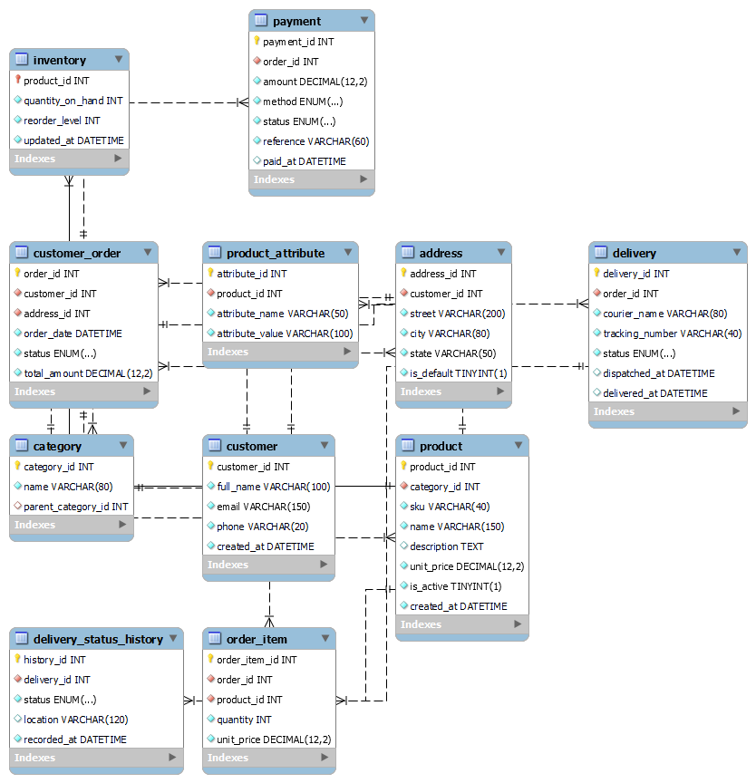
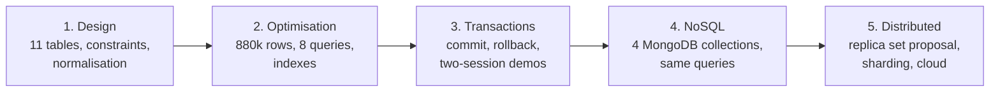
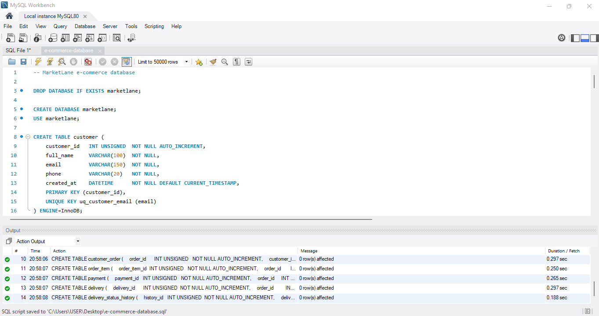

# Advanced Database Systems Portfolio

**MIT 8103 · September 2026 Cohort**

One e-commerce case study, taken from a blank schema to a distributed design in five portfolios.

---

| | |
|---|---|
| **Student** | Jackson-Igiebor Jacqline |
| **Student ID** | 2026/A/MIT/0220 |
| **Course** | MIT 8103 Advanced Database Systems |
| **Case study** | MarketLane, a simulated Nigerian online store |
| **Repository** | https://github.com/JacqlineCPE/advance-database-portfolio |

---

## Contents

1. [The case study](#the-case-study)
2. [How the portfolios fit together](#how-the-portfolios-fit-together)
3. [Portfolio 1: Database design](#portfolio-1-database-design)
4. [Portfolio 2: Query optimisation](#portfolio-2-query-optimisation)
5. [Portfolio 3: Transactions and concurrency](#portfolio-3-transactions-and-concurrency)
6. [Portfolio 4: NoSQL data models](#portfolio-4-nosql-data-models)
7. [Portfolio 5: Distributed and cloud](#portfolio-5-distributed-and-cloud)
8. [Results at a glance](#results-at-a-glance)
9. [Software used](#software-used)
10. [Running everything from the start](#running-everything-from-the-start)
11. [How this was built](#how-this-was-built)

---

## The case study

MarketLane is a made-up online store that sells electronics, fashion, home goods and groceries across Nigeria. Customers browse products, place orders, pay by card, bank transfer or on delivery, and track their parcels until they arrive.

The database holds products and their attributes, stock levels, customers and their addresses, orders and the items in them, payments, and delivery records with a history of status changes.

I picked e-commerce because every part of the assessment has a natural place in it. Stock gives two customers something to compete for in the concurrency work. Product attributes that differ by type give the NoSQL work a real reason to exist. And a shop that stops selling when its database goes down is a clear way to think about replication.

  
   
  <em>The eleven tables, as reverse-engineered from the live schema in MySQL Workbench</em>

---

## How the portfolios fit together

Each portfolio builds on the one before it. The schema from Portfolio 1 is what gets loaded, indexed, locked, converted and replicated in the others.

| Portfolio | Folder | Question it answers |
|---|---|---|
| 1 | [portfolio-1-database-design](portfolio-1-database-design) | What does the data look like, and what rules must it obey? |
| 2 | [portfolio-2-query-optimisation](portfolio-2-query-optimisation) | How fast are the queries, and what do indexes change? |
| 3 | [portfolio-3-transactions-concurrency](portfolio-3-transactions-concurrency) | What happens when two people act on the same row at once? |
| 4 | [portfolio-4-nosql](portfolio-4-nosql) | Which parts of MarketLane fit a document store better than tables? |
| 5 | [portfolio-5-distributed-cloud](portfolio-5-distributed-cloud) | How would MarketLane survive a database server failing? |

Every folder has its own README with the files explained, how to run them, and the results with screenshots.

---

## Portfolio 1: Database design

**Folder:** [portfolio-1-database-design](portfolio-1-database-design)

The MarketLane schema in MySQL 8: eleven InnoDB tables with primary and foreign keys, unique keys, `CHECK` constraints and `ENUM` status columns. The normalisation write-up starts from one flat order form and splits it into tables through 1NF, 2NF and 3NF, then explains the two places where redundant data is kept on purpose. A test script tries twelve writes, ten of which the constraints must refuse.

| File | What it is |
|---|---|
| `e-commerce-database.sql` | Creates the database and all eleven tables |
| `seed-data.sql` | Five customers, eight products, five orders in every status |
| `test-constraint.sql` | Twelve constraint tests |
| `normalisation.md` | 1NF to 3NF walkthrough |

  
   
  <em>Every CREATE TABLE completing in Workbench</em>

---

## Portfolio 2: Query optimisation

**Folder:** [portfolio-2-query-optimisation](portfolio-2-query-optimisation)

A data generator in plain SQL loads about 880,000 rows: 100,005 orders, 250,008 order items, 285,007 delivery history entries. Eight business queries are written, their execution plans captured with `EXPLAIN ANALYZE`, three indexes added (and three tried and rejected), and the plans captured again. The analysis explains what changed and, just as usefully, what did not.

| File | What it is |
|---|---|
| `generate-data.sql` | The bulk data generator |
| `queries.sql` | The eight queries |
| `explain-before.txt` / `explain-after.txt` | Full execution plans from my laptop |
| `indexes.sql` / `indexes-rejected.sql` | What was kept and what was dropped, with reasons |
| `performance-analysis.md` | Before and after, and why |

  
   
  <em>The orders table after indexing: the new three-column index shows as three rows</em>

---

## Portfolio 3: Transactions and concurrency

**Folder:** [portfolio-3-transactions-concurrency](portfolio-3-transactions-concurrency)

Placing an order as a transaction, with a commit, a rollback when stock runs out, and a savepoint that keeps part of an order. Then two Workbench tabs run step by step against the same stock row to show a dirty read, a non-repeatable read, a lost update, and a deadlock, and what stops each one.

| File | What it is |
|---|---|
| `place-order.sql` | Commit, rollback and savepoint in one tab |
| `session-a.sql` / `session-b.sql` | The two sides of the four concurrency demos |
| `reset.sql` | Puts the demo stock back between runs |
| `transaction-analysis.md` | What happened in each demo and why |

  
   
  <em>The CHECK constraint from Portfolio 1 refusing a sale with no stock</em>

---

## Portfolio 4: NoSQL data models

**Folder:** [portfolio-4-nosql](portfolio-4-nosql)

The same data rebuilt as MongoDB documents. Eleven tables become four collections; the order document alone replaces six tables. The eight Portfolio 2 queries are rewritten as finds and aggregation pipelines, numbered to match so the SQL and MongoDB versions can be read side by side. The suitability write-up covers where documents fit MarketLane, where they do not, and where key-value, column-family and graph models would each come in.

| File | What it is |
|---|---|
| `document-model.md` | Tables to collections, with the embed-or-reference decision for each |
| `products.json`, `orders.json`, `customers.json`, `categories.json` | The seed data as documents |
| `indexes.js` / `queries.js` | Indexes and the eight queries, run in the Compass shell |
| `suitability.md` | The four NoSQL models against MarketLane |

  
   
  <em>Three of the queries running in MongoDB Compass</em>

---

## Portfolio 5: Distributed and cloud

**Folder:** [portfolio-5-distributed-cloud](portfolio-5-distributed-cloud)

A discussion, not a deployment. It describes how the databases run now (one MySQL server and one MongoDB server on one laptop), proposes a three-member MongoDB replica set and a MySQL read replica, works through what happens when the primary fails, and covers sharding and a managed cloud deployment. One script runs: it shows the MySQL binary log that replication would read from.

| File | What it is |
|---|---|
| `distributed-design.md` | The proposal, with references to the official documentation |
| `sharding.md` | Shard-key options for the orders collection |
| `mysql-binlog.sql` | Shows one stock update inside the binary log |

  
   
  <em>One UPDATE as five events in the binary log: this is what a replica would receive</em>

---

## Results at a glance

| | Result |
|---|---|
| Tables designed | 11, with 12 foreign keys, 8 unique keys and 7 CHECK constraints |
| Constraint tests | 10 of 10 bad writes refused |
| Rows generated | about 880,000 across 10 tables |
| Biggest query win | Q8 (unpaid orders): 142 ms to 21 ms after indexing |
| Query that got slower | Q7: the index matched 60% of rows and added a detour |
| Lost update | Both sessions wrote stock = 2; `SELECT ... FOR UPDATE` fixed it to 1 |
| Deadlock | Error 1213 within a second; InnoDB rolled back one session |
| Collections | 4, replacing 11 tables |
| Replica set | Proposed: 3 members, write concern `majority`, 12-second median failover |

---

## Software used

| Tool | Version | Used for |
|---|---|---|
| MySQL Community Server | 8.0 | Portfolios 1 to 3, and the binary log in Portfolio 5 |
| MySQL Workbench | 8.0 | Running scripts, EER diagram, screenshots |
| MongoDB Community Server | 8.0 | Portfolio 4 |
| MongoDB Compass | 1.x | Importing data, running the shell, screenshots |

Everything runs on one Windows laptop. Nothing is deployed to a cloud service; Portfolio 5 explains how it could be.

---

## Running everything from the start

1. **Portfolio 1:** run `e-commerce-database.sql`, then `seed-data.sql`.
2. **Portfolio 2:** run `generate-data.sql` (raise the Workbench read timeout first), then `explain-before.sql`, `indexes.sql`, `explain-after.sql`.
3. **Portfolio 3:** run `place-order.sql`, then the two session scripts step by step in two tabs, with `reset.sql` between demos.
4. **Portfolio 4:** import the four JSON files into a `marketlane` database in Compass, then run `indexes.js` and `queries.js` in the shell.
5. **Portfolio 5:** run `mysql-binlog.sql`.

The folder READMEs have the details.

---

## How this was built

The numbers in the write-ups are from my own runs. Execution plans, timings, row counts and error messages were taken from Workbench and Compass on my laptop and saved into the text files in each folder. Where a result did not match what I expected, it is written up rather than left out. Portfolio 2's Q7 getting slower after indexing and Portfolio 3's rollback error naming a different constraint than I expected are both in the analysis files.

I used an AI assistant (Claude) during the work, for help planning each portfolio, drafting SQL and JavaScript, and editing the write-ups. Every script was run by me, the outputs in this repository are mine, and the writing was read and corrected by me. The full declaration is in the final summary submitted on the LMS.
