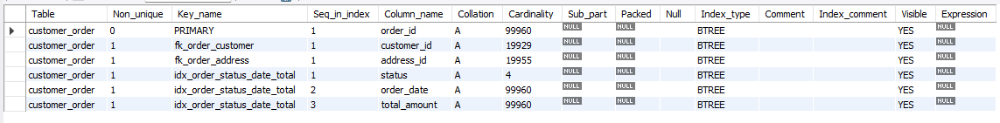
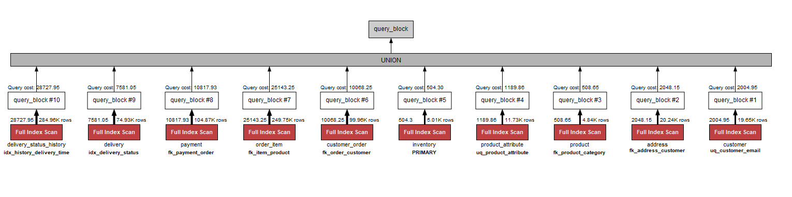

# Portfolio 2: Query Processing and Optimisation

This is the second part of my Advanced Database Systems portfolio (MIT 8103). It uses the MarketLane database from Portfolio 1. The work was to load enough data for performance to matter, write queries the business would actually run, look at how MySQL executes them, add indexes, and measure the difference.

Everything was done on MySQL 8.0 using MySQL Workbench.

## What is in this folder

| File | What it is |
|---|---|
| `generate-data.sql` | Loads about 880,000 rows of test data on top of the Portfolio 1 seed data |
| `queries.sql` | The eight business queries |
| `explain-before.sql` | The eight queries wrapped in `EXPLAIN ANALYZE`, run before indexing |
| `explain-before.txt` | The plans from that run |
| `indexes.sql` | The three indexes I kept |
| `indexes-rejected.sql` | Three indexes I tried and removed, with reasons |
| `explain-after.sql` | The eight queries plus one rewrite, wrapped in `EXPLAIN ANALYZE`, run after indexing |
| `explain-after.txt` | The plans from that run |
| `performance-analysis.md` | The before and after comparison and what I learned |
| `generated-data-execution-plan.png` | Workbench Visual Explain of the row-count query |
| `show-index-customer-order-screenshot.png` | `SHOW INDEX` output for the orders table after indexing |

## Loading the data

The Portfolio 1 seed data has five orders. That is not enough to see what an index does, so `generate-data.sql` adds 20,000 customers, 5,000 products and 100,000 orders spread over two years, along with the order items, payments, deliveries and delivery history that go with them. The biggest tables afterwards are `delivery_status_history` with 285,007 rows, `order_item` with 250,008 and `customer_order` with 100,005.

The script is plain SQL. A recursive CTE builds a helper table of the numbers 1 to 100,000, and each `INSERT ... SELECT` reads from it. Values are worked out with arithmetic rather than `RAND()`, so the script gives the same data every time. That matters when comparing timings. The whole load runs in one transaction with all the Portfolio 1 constraints switched on, and the last statement prints a row count for every table.

One thing to know before running it in Workbench: the order-item insert takes longer than the default 30-second read timeout, and Workbench drops the connection. Go to Edit → Preferences → SQL Editor → MySQL Session and set *DBMS connection read timeout interval* to 600, then reconnect. If the connection does drop, the transaction rolls back and the script can just be run again.

## The queries

`queries.sql` has eight queries. Each one has a comment saying who at MarketLane would run it.

| Query | What it answers | Rows |
|---|---|---|
| Q1 | A customer's order history, newest first | 5 |
| Q2 | Orders and revenue per month for the last twelve months | 12 |
| Q3 | The ten best-selling products in the first half of 2026 | 10 |
| Q4 | Products at or below their reorder level | 193 |
| Q5 | The latest status of every delivery still in transit | 50 |
| Q6 | Products that are both black and 128GB | 85 |
| Q7 | The top three customers by spend in each state | 24 |
| Q8 | Pending orders with no successful payment, oldest first | 100 |

Between them they use joins across up to four tables, `GROUP BY` with aggregates, a correlated subquery, a `NOT EXISTS` check, a self-join on the attribute table, and a `RANK()` window function.

`queries.sql` does not start with `USE marketlane;`, so select the schema in Workbench before running it.

## Execution plans before indexing

`EXPLAIN ANALYZE` runs a query for real and prints a tree of every step the engine took, with the actual time and row count at each step. `explain-before.sql` is the eight queries with that in front of each one.

I ran it twice and kept the second set of plans. The first run reads pages from disk; the second shows what the query costs once the data is in memory, which is a fairer comparison. Workbench returns each plan as one cell in the result grid and truncates it, so I opened each cell with *Open Value in Viewer* and copied the full text into `explain-before.txt`.

Three things to look for in a plan. `Table scan on X` means every row was read; `Index lookup` or `Index range scan` means the engine went straight to the matching rows. `actual time=a..b` is the time in milliseconds to the first row and to the last row, and the top line's second number is the whole query. `rows=N loops=M` is how many rows a step returned and how many times it ran, so `rows=3 loops=45003` is a small lookup repeated 45,003 times.

Five of the eight queries start with a full scan of either `customer_order` or `delivery`, because nothing was indexed on `status` or `order_date`.

## Adding indexes

`indexes.sql` adds three indexes and then runs `ANALYZE TABLE` so the optimiser's statistics are up to date. The first is on `customer_order (status, order_date, total_amount)` and covers four of the queries. The second is on `delivery_status_history (delivery_id, recorded_at)` so the latest status for a delivery is one index read. The third is on `delivery (status)`, because only a fifth of deliveries are in transit. Each one has a comment saying which query it is for.

This is `SHOW INDEX FROM customer_order` after running `indexes.sql`. The first three rows are the primary key and the two foreign-key indexes MySQL made on its own in Portfolio 1. The last three rows are the new index, one row per column, with `Seq_in_index` showing the column order. The `Cardinality` column is the optimiser's estimate of how many distinct values each column has. It thinks `status` has 4 (there are five, but the number comes from sampling), which is why `status` on its own would be a poor index and why it is combined with `order_date`.

This is Workbench's Visual Explain for the row-count query at the end of `generate-data.sql`, run after the indexes were in place. Each `COUNT(*)` is a full scan of one index on its table, and the engine picks the smallest index it has, which is why `delivery_status_history` and `delivery` are counted through the two new indexes. The row figures are estimates from table statistics, so they sit slightly below the real counts.

`indexes-rejected.sql` has three indexes I tried first and took out. An index on `status` alone was never used because every status matches too many rows. A covering index on `order_item` lost to the unique key already on that table. And an index with `order_date` before `status` would force a scan of the whole date range, because MySQL can only use a range condition on the last index column it reads. The reasons are in the file as comments, with the `CREATE INDEX` lines commented out.

## Execution plans after indexing

`explain-after.sql` is the same eight queries plus Q5b, which is Q5 rewritten with `ROW_NUMBER()` instead of a correlated subquery. I wanted to show that changing the query can matter as much as adding an index. I ran this script twice too and copied the second set of plans into `explain-after.txt`.

## What happened

The comparison and the reasoning are in `performance-analysis.md`. The short version:

| Query | Before | After | Change |
|---|---|---|---|
| Q8 | 142 ms | 21 ms | −85% |
| Q2 | 384 ms | 216 ms | −44% |
| Q5b (rewrite) | 1,395 ms | 1,009 ms | −28% |
| Q5 | 1,395 ms | 1,064 ms | −24% |
| Q3 | 1,638 ms | 1,551 ms | −5% |
| Q7 | 1,036 ms | 1,111 ms | +7% |
| Q1, Q4, Q6 | — | — | plan unchanged |

Q8 went from a table scan and a sort to an index range scan with no sort. Q2 went to a covering index that never touches the table. Q7 got a little worse, because its filter matches 60% of the table and the index is just a detour. Q3 hardly moved, because the slow part of that query is not on `customer_order`.

## Running it in order

Start with the Portfolio 1 schema and seed data, then:

1. Run `generate-data.sql` and check the row counts it prints at the end.
2. Run `explain-before.sql` twice and keep the second set of plans.
3. Run `indexes.sql`.
4. Run `explain-after.sql` twice and keep the second set.
