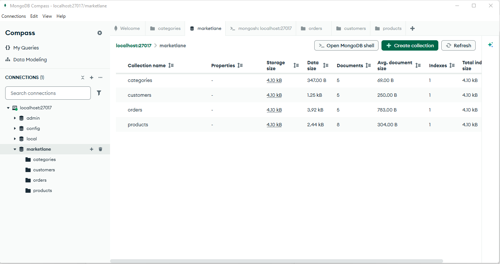
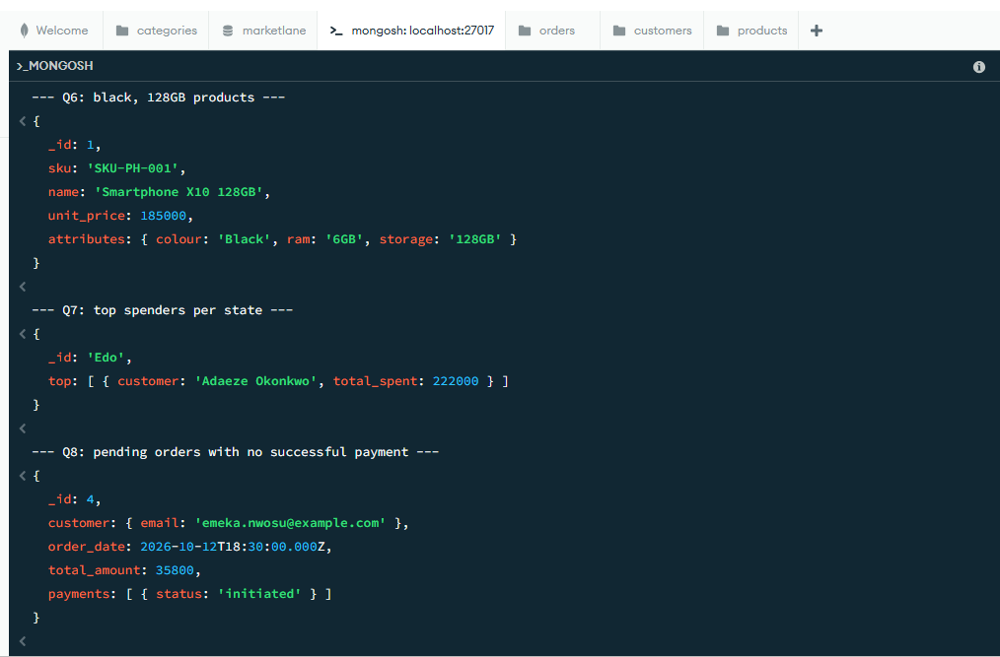

# Portfolio 4: NoSQL and Advanced Data Models

This is the fourth part of my Advanced Database Systems portfolio (MIT 8103). It takes the MarketLane case study from Portfolios 1 to 3 and rebuilds part of it as a document database in MongoDB. The work was to design the document model, load the same seed data, write the same business queries the MongoDB way, and then explain where a document store fits MarketLane better than MySQL, where it fits worse, and where the key-value, column-family and graph models would each come in.

The database is MongoDB Community Server 8.0, with MongoDB Compass as the desktop tool. Compass has a built-in shell at the bottom of the window, and that is where the scripts run.

## What is in this folder

| File | What it is |
|---|---|
| `document-model.md` | How the eleven MySQL tables became four collections, with the embed-or-reference decision for each |
| `categories.json` | 5 documents |
| `products.json` | 8 documents, attributes and stock embedded |
| `customers.json` | 5 documents, addresses embedded |
| `orders.json` | 5 documents, items, payments, delivery and history embedded |
| `indexes.js` | Eight indexes, including a wildcard index on product attributes |
| `queries.js` | The eight Portfolio 2 questions in MongoDB form, two writes, a `$lookup`, and an explain |
| `suitability.md` | Where documents, key-value, column-family and graph each fit MarketLane |
| `compass-collections-screenshot.png` | The four collections loaded in Compass |
| `query-results-screenshot.png` | Q6, Q7 and Q8 output in the Compass shell |

## The model

The product attribute problem from Portfolio 1 is the starting point. In MySQL a phone's storage and a shirt's size had to go in a name/value table because they are different columns, and filtering on two attributes at once was a self-join. In MongoDB a product is one document and its attributes are fields inside it:

```json
"attributes": { "colour": "Black", "ram": "6GB", "storage": "128GB" }
```

An order works the same way. The items, the payment attempts, the delivery and its status history are all inside the order document, along with a copy of the customer's name and the delivery address as they were when the order was placed. Six MySQL tables and two joins become one document.

The rule for what to embed and what to reference: embed when the child belongs to one parent and there will only ever be a few of them; reference when the child has its own life. So items are embedded, but each item carries a `product_id` that points back to the `products` collection, because products are shared across thousands of orders and change independently. `document-model.md` goes through every table.

## The data

The four JSON files hold the Portfolio 1 seed data reshaped into documents. I built them from the MySQL tables rather than typing them, so every number matches: 14 attributes, 6 payments, 7 delivery history entries, and every order total equals the sum of its items. Dates are in Extended JSON form (`{"$date": "..."}`) so Compass imports them as real dates rather than strings, which the monthly revenue pipeline depends on.

## Loading it

In Compass, connected to `localhost:27017`:

1. Click the `+` next to Databases, name it `marketlane`, and give it a first collection called `categories`.
2. Open the `categories` collection, click *ADD DATA → Import JSON or CSV file*, and pick `categories.json`.
3. Create `products`, `customers` and `orders` the same way (the `+` next to the database name) and import their files.
4. Open the shell at the bottom of the window (the `>_MONGOSH` bar) and run `indexes.js`, either with `load("C:/full/path/to/indexes.js")` or by pasting its lines in. It prints the index names on each collection when it is done.



This is the database after the four imports. The Documents column shows 5 categories, 5 customers, 5 orders and 8 products, which matches the row counts of the parent tables in MySQL. The average document size column makes the embedding visible: an order document is 783 bytes because it carries its items, payments, delivery and history, while a category is 69 bytes. The one index on each collection at this point is the `_id` index MongoDB creates on its own; `indexes.js` adds the rest.

## The queries

`queries.js` has the eight questions from Portfolio 2, numbered to match, so the SQL and the MongoDB versions can be read side by side.

| | Question | SQL needed | MongoDB needs |
|---|---|---|---|
| Q1 | A customer's orders with item counts | Join and GROUP BY | `find` with `$size` |
| Q2 | Monthly revenue | GROUP BY on a date expression | `$group` on `$dateToString` |
| Q3 | Top products by units sold | Four-table join | `$unwind` the items, then `$group` |
| Q4 | Products at or below reorder level | Join to inventory | `$expr` comparing two fields in one document |
| Q5 | Latest status of in-transit deliveries | Correlated subquery, 45,003 runs | Last element of the history array |
| Q6 | Black and 128GB | Self-join on the attribute table | A filter on two fields |
| Q7 | Top spenders per state | Window function | Two `$group` stages and `$slice` |
| Q8 | Pending orders with no successful payment | `NOT EXISTS` subquery | `$not` with `$elemMatch` on the payments array |

After the eight reads there are two writes. `W1` sells one unit of a product with the stock check and the decrement in a single `findOneAndUpdate`, which is the Portfolio 3 lost-update problem solved in one statement: the filter `quantity_on_hand >= 1` and the `$inc` happen together under the document lock, so two buyers cannot both get the last unit. Run against product 6, which has no stock, it returns `null` and changes nothing. `W2` marks order 2 as delivered by setting the status and pushing a new entry onto the embedded history in one write.

`L1` is a `$lookup`, included to show that joins exist when they are needed. It pulls the current product document into each item of order 1 so the price paid can be compared with today's price.

`X1` runs `explain` on Q6 and prints the index it used. It should name `idx_attributes`, the wildcard index, and show one document examined out of eight.

The script prints a heading before each block, so running the whole file with `load()` gives one readable transcript.

## What the queries return

With the seed data: Q1 gives two orders for customer 1 (one delivered, one cancelled). Q2 gives one month, 2026-10, with 3 counted orders and revenue 506,500. Q3 gives the power bank (2 units) ahead of the Smartphone X10 (1 unit). Q4 lists the Smartphone Pro (3 in stock, reorder at 5) and the Leather Sandals (0). Q5 gives order 2, in transit at Allen Avenue route. Q6 gives the Smartphone X10. Q7 gives one state, Edo, with Adaeze Okonkwo at 222,000. Q8 gives order 4, whose only payment is still initiated. The two writes leave the Smartphone Pro at 2 in stock and order 2 delivered with four history entries.



This is the shell output for the last three reads. Q6 returns the one product whose embedded `attributes` object has both `colour: 'Black'` and `storage: '128GB'`, with no join involved. Q7 returns one document per state, with the top spenders as an array inside it, which is a shape a SQL result set cannot take. Q8 returns order 4 and shows why: its `payments` array has a single entry and its status is `initiated`, so `$not: { $elemMatch: { status: 'successful' } }` matches.

## Suitability

`suitability.md` is the explanation. In short: documents fit the catalogue and the order record well, and most of the Portfolio 2 queries got simpler. They fit reporting across all orders less well, and they leave referential integrity and cross-collection consistency to the application. Redis would hold the cart and the flash-sale counter, Cassandra the delivery event stream if it grew large, and Neo4j the "also bought" recommendations. MySQL would stay as the record of truth for money and stock. Each model fits the part of MarketLane that has its shape.

## Running it in order

1. Install MongoDB Community Server with Compass, connect to `localhost:27017`.
2. Create the `marketlane` database and import the four JSON files.
3. Run `indexes.js` in the shell.
4. Run `queries.js` in the shell.
