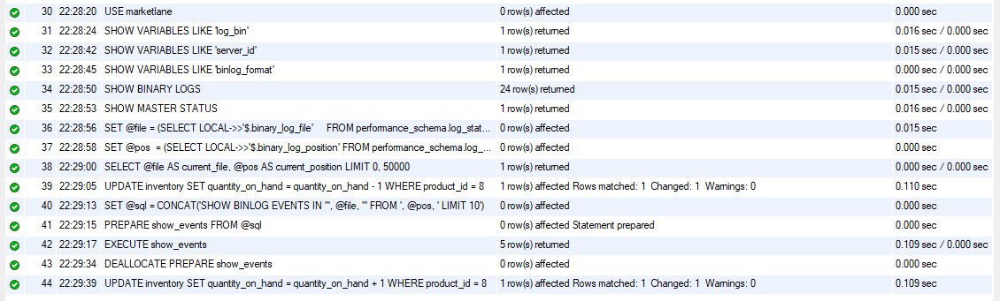
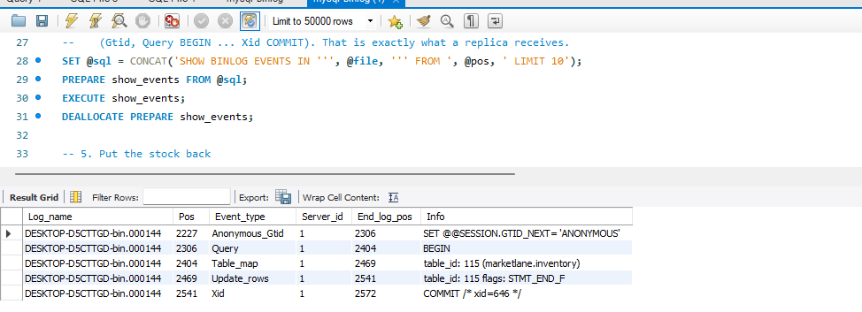

# Portfolio 5: Distributed and Cloud Database Exercise

This is the last part of my Advanced Database Systems portfolio (MIT 8103). The brief allows either a discussion or a setup. I took the discussion route. The files here describe how the MarketLane databases run now (one MySQL server and one MongoDB server on one laptop) and how they could be set up to survive a server failure. Nothing in this folder has been deployed. The replica set and the cloud deployment are proposals and are labelled as proposals.

## What is in this folder

| File | What it is |
|---|---|
| `distributed-design.md` | The discussion: current setup, proposed replication, failure and consistency, sharding and cloud deployment, with references |
| `mysql-binlog.sql` | Shows the binary log on the existing MySQL server, which is what a replica would read. This is the only file in the folder that runs |
| `sharding.md` | A shard-key plan for the `orders` collection, and why I did not deploy it |
| `binlog-script-output-screenshot.png` | Workbench Action Output from running `mysql-binlog.sql` |
| `binlog-events-screenshot.png` | The five binary log events for one stock update |

## The question

If the server holding MarketLane's data stopped, what would customers notice, and what could stop them noticing?

Portfolio 3 looked at two sessions on one server competing for the same stock row. This portfolio looks at what happens when the server itself fails and what a second server would need in order to take over.

## What the discussion covers

**Current setup.** What is actually running: a single MySQL server holding orders, payments and stock, and a single MongoDB server holding the catalogue and order documents. One copy of everything, no replica set, no second server, no failover tested, and the two databases not synchronised with each other.

**Proposed replication.** A three-member MongoDB replica set with one primary and two secondaries on separate hosts, with a table of the members. It follows a Portfolio 4 write (`W2`, the delivery status update) from the primary to the secondaries and explains why a secondary can be slightly behind. It also covers MySQL's own source-to-replica replication, which would give a read replica for the Portfolio 2 reports, and makes clear that neither database's replication copies the other's data. `mysql-binlog.sql` is the runnable part: it shows that the binary log MySQL replication depends on is already being written on the single server, and what one stock update looks like inside it.

This is the Workbench Action Output after running the script block by block. Every line has a green tick. `SHOW BINARY LOGS` returned 24 rows, meaning the server has written 24 log files since it was installed. The `SET @file` and `SET @pos` lines read the current file name and position from `performance_schema.log_status`, the `UPDATE` takes one unit off product 8, and `EXECUTE show_events` returns 5 rows. The last line puts the unit back.

This is the result of `EXECUTE show_events`: the five events that one `UPDATE` produced in the log. `Query BEGIN` opens the transaction, `Table_map` names the table (`marketlane.inventory`), `Update_rows` holds the before and after values of the row, and `Xid` is the commit. The log file is called `DESKTOP-D5CTTGD-bin.000144` because MySQL on Windows names the files after the computer by default. A replica connected to this server would read these five events and apply the same change to its own copy of `inventory`. This is the mechanism; the replica itself is not set up.

**Failure and consistency.** What happens when the primary's host fails: the election timeout, the majority vote, the few seconds where writes fail and have to be retried, and why the set becomes read-only when there is no majority instead of risking two primaries. Why order writes should use write concern `majority` and what that costs. Why stock reads go to the primary and catalogue reads can go to a secondary. And the point that a replica set is what makes MongoDB multi-document transactions available, which was missing in Portfolio 4.

**Sharding and cloud deployment.** The difference between copying data and splitting it, why 100,005 orders and 48 MB do not need splitting, and what the shard key for orders would be if they ever did. `sharding.md` goes further, with three candidate keys compared against the Portfolio 2 queries, the commands that would be used, and the cost of sharding in cross-shard transactions and unique indexes. Then what a managed service such as MongoDB Atlas would add, and the four things that would need to be set up before real customers used it: authentication, encryption, restricted network access, and backups that have been tested by restoring them. Why replication is not a backup. Cost as the main limitation, and the fact that the two databases would still need separate arrangements.

## How this fits the earlier portfolios

Portfolio 1's `inventory` table and Portfolio 3's row locks are why MySQL stays the record of truth in the proposed design. Portfolio 2's heavy report queries are why a MySQL read replica would be useful. Portfolio 4 noted that multi-document transactions need a replica set, and this portfolio proposes one. The design does not replace any of the earlier work. It puts copies of it on more than one machine.

## Sources

The claims about how MongoDB and MySQL behave come from the official documentation. Each link is placed next to the claim it supports in `distributed-design.md`, and the full list is at the end of that file.
