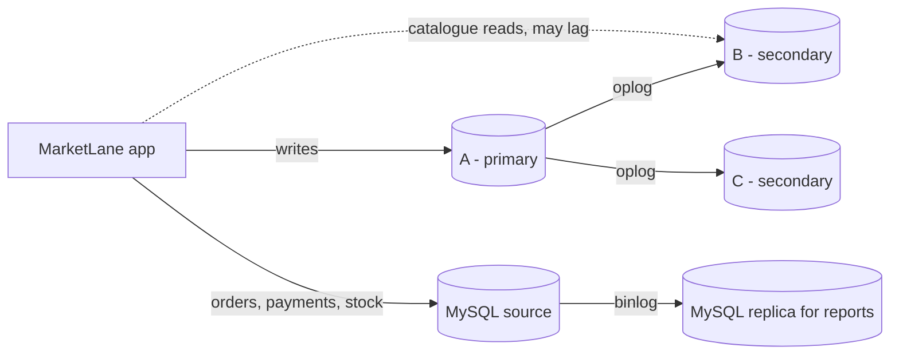

# Distributed design for MarketLane

This file looks at what would happen if a MarketLane database server failed, and what could be done about it. It is a proposal. I have not set up a replica set or a cloud deployment. Where I say "proposed", nothing has been built or tested.

## Current setup

All the work in Portfolios 1 to 4 runs on one laptop.

| Database | Version | What it holds | How it runs |
|---|---|---|---|
| MySQL | 8.0 Community | Orders, payments, stock, customers (Portfolios 1 to 3) | One server, installed as a Windows service, used through Workbench |
| MongoDB | 8.0 Community | Catalogue and order documents (Portfolio 4) | One `mongod` process, installed as a Windows service, used through Compass |

Each database is a single server with one copy of the data. There is no replica set, no second MySQL server, and I have not tested any kind of failover. If the laptop is switched off, both databases are unavailable.

The two databases are also separate from each other. Stock is stored in a MySQL row and in a MongoDB document, and nothing keeps the two values in step except the application.

## Proposed replication

Replication keeps copies of the same data on different servers. In MongoDB this is done with a replica set. A replica set is a group of `mongod` processes with the same data. One of them is the primary and takes all the writes. The others are secondaries. They read the primary's operation log (the oplog) and apply the same changes to their own copy ([MongoDB replication](https://www.mongodb.com/docs/manual/replication/)).

The proposed replica set for the MarketLane catalogue and order documents has three members. Each one holds a full copy of the data and each one has a vote.

| Member | Starting role | Location |
|---|---|---|
| A | Primary: takes all writes to `products` and `orders` | Host 1, zone 1 |
| B | Secondary: copies A's changes | Host 2, zone 2 |
| C | Secondary: copies A's changes | Host 3, zone 3 |

The three hosts would be on separate machines with separate power and network, so one failure does not affect every copy.

As an example, take the Portfolio 4 write `W2`, which marks order 2 as delivered and adds a new entry to its embedded history. The application sends the write to A. A applies it and records it in the oplog. B and C read the oplog and apply the same change. This copying is asynchronous, so for a short time B or C can be behind A. If a customer refreshed the tracking page and the read went to a secondary in that moment, they could see "in transit" when the primary already had "delivered". This is the normal trade-off: writes do not wait for every copy, so copies can lag slightly.

MySQL has its own replication. The source server writes every change to a binary log, and replicas read that log and apply the changes. This is also asynchronous by default ([MySQL replication](https://dev.mysql.com/doc/refman/8.0/en/replication.html)). The binary log is already turned on in the MySQL server from Portfolios 1 to 3, because MySQL 8 enables it by default. `mysql-binlog.sql` shows this. It runs one stock update and then reads the log, where the update appears as a `Table_map` event and an `Update_rows` event inside a transaction. That is what a replica would receive. No replica is connected at the moment.

For MarketLane, the most useful MySQL replica would be a read replica for reporting. The Portfolio 2 queries that scan all 100,005 orders, such as monthly revenue and top products, could run on the replica so they do not slow down checkout on the source.

MongoDB's replica set does not copy MySQL data, and MySQL's replica does not copy MongoDB data. They are two separate setups, and they would still not synchronise with each other.

## Failure and consistency

Suppose Host 1 fails and member A goes down. B and C stop hearing from A. After the election timeout (10 seconds by default) the members that can still reach each other hold an election, and the first one to get a majority of votes becomes the new primary. With three voting members, a majority is two, so B and C can elect one of themselves. While the election is running, the replica set cannot accept writes. The documentation says the median time to elect a new primary should not normally be more than 12 seconds with default settings ([replica set elections](https://www.mongodb.com/docs/manual/core/replica-set-elections/)). For MarketLane that means a few seconds where a checkout write to MongoDB would fail and the application would need to retry. Customers browsing the catalogue would not notice, because reads can continue from a secondary.

If two hosts fail, or the network splits so that no member can see the other two, there is no majority. The remaining member steps down to secondary and the set becomes read-only until a majority is available again. This is intended. It is better for MarketLane to stop taking orders for a short time than to have two members both acting as primary and both selling the last unit of a product. This is choosing consistency over availability, and for stock levels that is the right choice.

For important writes, such as inserting an order, the proposal uses write concern `majority`. The application does not get an acknowledgement until two of the three members have the change written durably in their oplog. A write acknowledged this way is safe if the primary fails right afterwards, because at least one other member already has it. A write acknowledged by the primary only (`w: 1`) can be rolled back if the primary fails before a secondary copies it ([write concern](https://www.mongodb.com/docs/manual/reference/write-concern/)). The cost is that every order write waits for a second member, which is a few milliseconds when the hosts are in the same region.

For reads, anything on the checkout path, such as a stock check, would read from the primary. Catalogue browsing could read from a secondary, because a product description being a second out of date does not matter.

A replica set also makes something possible that was not possible in Portfolio 4. MongoDB multi-document transactions only work on replica sets and sharded clusters, not on a standalone server ([transactions](https://www.mongodb.com/docs/manual/core/transactions/)). On the proposed replica set, taking stock off a product and inserting the order document could be done in one transaction. That closes the gap I noted in the Portfolio 4 suitability file, where the two writes were separate and the second could fail after the first succeeded.

MySQL would still be the record of truth. If MongoDB and MySQL ever disagreed about stock, MySQL would be right, because that is where the constraints from Portfolio 1 and the locks from Portfolio 3 are. The replica set makes the MongoDB copy more available. It does not make it the authority.

## Sharding and cloud deployment

Replication copies the whole data set onto every member. Sharding splits the data so that each shard holds only part of it. Sharding is for when one replica set cannot hold all the data or handle all the load. Each shard is a replica set of its own. A `mongos` router sends each query to the right shard, and config servers keep the map of which data is on which shard ([sharding](https://www.mongodb.com/docs/manual/sharding/)).

MarketLane does not need sharding. The Portfolio 2 data set is 100,005 orders and 5,008 products, which was about 48 MB of table data in MySQL. One replica set can hold far more than that. If MarketLane grew enough to need it, the `orders` collection is the one that would be split, and the shard key would need to be chosen carefully. A customer's orders should be on one shard so that the "my orders" page only touches one shard, which points to a hashed key on `customer.id`. Sharding on `order_date` would be a bad choice because all new orders have today's date and would all go to the same shard while the others sat idle. The documentation also warns that queries which do not include the shard key are sent to every shard, and that a bad shard key is hard to change later. `sharding.md` compares three candidate keys against the Portfolio 2 queries and lists what sharding would cost. No sharding is proposed at this stage.

A cloud version of the replica set would use a managed MongoDB service instead of three servers I run myself. MongoDB Atlas deploys a cluster as a replica set, can place the members in different availability zones, handles elections and patching, and takes scheduled snapshots that can be restored ([Atlas backup and restore](https://www.mongodb.com/docs/atlas/backup-restore-cluster/)). Before real customers used it, four things would need to be in place:

- Authentication. The MongoDB in Portfolio 4 accepts connections with no username or password. That is fine on a laptop and not acceptable anywhere else.
- Encryption. TLS on every connection so order data cannot be read on the network.
- Restricted access. An IP access list so only the application servers can connect.
- Tested backups. A snapshot only counts as a backup once it has been restored and checked.

Replication is not a backup. If someone ran the Portfolio 3 `reset.sql` against the wrong database, or a bug deleted orders, the deletion would be copied to every member within seconds. Only a snapshot taken before the mistake would get the orders back.

The main limitation is cost. A three-member managed cluster is a monthly bill, and a managed MySQL service for the record of truth would be a second bill. Both would need to be priced against what MarketLane earns. The two databases would also still be two separate systems. The MySQL service would need its own replication, its own backups and its own restore test, and nothing in either product keeps the MySQL stock row and the MongoDB stock field in agreement. That would still be the application's job, the same as it is now.

## References

- MongoDB replication: https://www.mongodb.com/docs/manual/replication/
- Replica set elections: https://www.mongodb.com/docs/manual/core/replica-set-elections/
- Write concern: https://www.mongodb.com/docs/manual/reference/write-concern/
- Transactions: https://www.mongodb.com/docs/manual/core/transactions/
- Sharding: https://www.mongodb.com/docs/manual/sharding/
- Atlas backup and restore: https://www.mongodb.com/docs/atlas/backup-restore-cluster/
- MySQL replication: https://dev.mysql.com/doc/refman/8.0/en/replication.html
